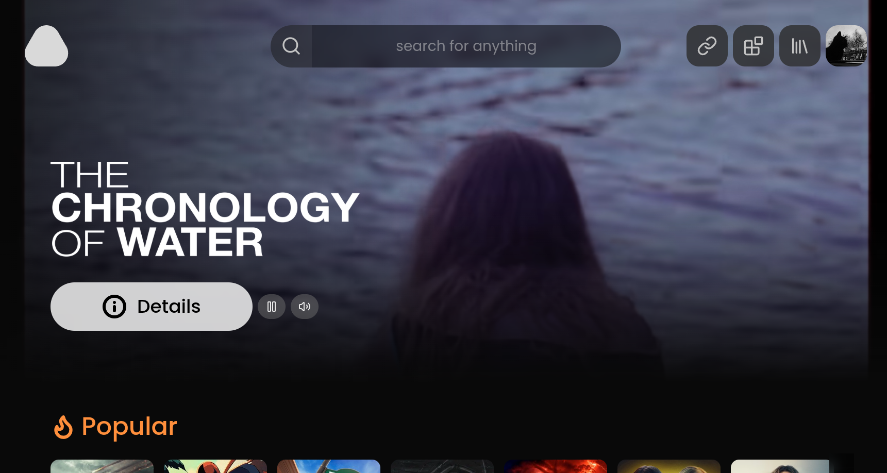

# Raffi



Raffi is a streaming app built around Stremio addons. Add the addons you already use, and everything they offer shows up in one library with a fast player, progress tracking and watch parties.

Raffi doesn't come with anything to stream. What you can watch depends on the addons you add.

**[Download](https://raffi.al)** · [Schelf](https://schelf.store/kaleidal/raffi) · [Report a bug](https://github.com/kaleidal/raffi/issues)

## What it does

- **Addons:** use any Stremio addon, several at once, or add your own direct link templates. You can also import your Stremio library.
- **Player:** switch audio and subtitle tracks, adjust subtitle delay, preview frames on the seek bar, skip intros and recaps, save clips, and keep watching in a mini player.
- **Audio:** Dolby Digital, Dolby Digital Plus, DTS and TrueHD all play in the app on desktop, and every text subtitle track in an MKV is available as it streams.
- **Library:** continue watching, per-episode progress, and your own lists, synced across devices with an account or kept on your device in local mode.
- **Watch parties:** synced playback with host controls.
- **Trakt:** connect with a short code to send your progress to your profile.
- **Torrents:** stream through [Limbo](https://limbo.kaleid.al), on the same computer or, for Android, on a paired computer on your network.
- **Discord:** optional Rich Presence showing what you're watching.

## Get Raffi

| Platform | Download | Updates |
| --- | --- | --- |
| Windows | `.exe` installer or `.msi` | Automatic |
| macOS (Apple silicon) | `.dmg` or `.zip` | Built unsigned, so macOS may block automatic updates |
| Linux | AppImage, `.deb` or `.rpm` | Automatic |
| Android, phones and TVs | Build from source, see [apps/android](apps/android/README.md) | Manual |

Windows and macOS builds aren't code-signed, so your system may warn you before opening them. Intel Macs can stay on 0.16.0, the last version built for them.

Not everything works everywhere yet:

| | Desktop | Web | Android |
| --- | --- | --- | --- |
| Debrid and direct HTTP streams | Yes | Only hosts that allow browser access | Yes |
| Torrents through Limbo | Yes | No | Yes |
| Local files | Yes | No | No |
| Saving clips | Yes | No | No |
| Watch parties | Yes | Yes | No |

## Development

You'll need [Bun](https://bun.sh).

```bash
git clone https://github.com/kaleidal/raffi.git
cd raffi
bun install

bun run dev:desktop
bun run dev:web
```

Android also needs JDK 25 and the Android SDK:

```bash
bun run apk:android
```

Before opening a pull request, run the type checks and every test suite. The desktop tests start Electron and decode real audio, so on a machine with no display, run this under `xvfb-run`:

```bash
bun run validate
```

### Layout

| Path | What's there |
| --- | --- |
| [`packages/app`](packages/app) | The Svelte app itself, shared by every platform |
| [`apps/desktop`](apps/desktop) | Electron shell |
| [`apps/web`](apps/web/README.md) | SvelteKit build for Cloudflare |
| [`apps/android`](apps/android/README.md) | Kotlin host for phones and TVs, with native playback through Media3 |
| [`services/sync`](services/sync/README.md) | Accounts, cloud sync, Trakt and watch parties, on Cloudflare Workers |
| [`marketing`](marketing) | The [raffi.al](https://raffi.al) site |

### Playback

Streams that the browser can play go straight to a `<video>` element, with HLS.js for HLS. Everything else goes through [MediaBunny](https://mediabunny.dev), which remuxes the stream in the app and decodes audio the browser can't, so there's no FFmpeg to ship. On Android, Media3 plays the video on a surface underneath the page.

Seek previews fetch only the keyframe they show. For MKV, Raffi reads the file's cue index itself, because going through MediaBunny would download the whole cluster around each frame.

### Building packages

```bash
bun --filter @raffi/desktop dist -- --win
bun --filter @raffi/desktop dist -- --mac
bun --filter @raffi/desktop dist -- --linux
```

Packages end up in `apps/desktop/release`. Build each one on its own system.

### Releasing

From an up-to-date `main`, with `gh` signed in and Wrangler logged in:

```bash
scripts/publish.sh 1.2.3
```

The script applies pending sync migrations, bumps the version, runs the release workflow, and publishes the release on GitHub and [Schelf](https://schelf.store/kaleidal/raffi). `--notes FILE` skips the editor, `--draft` leaves the GitHub release unpublished, and `--yes` skips the confirmation.

Pushing to `main` deploys the sync service and the website, so database migrations have to go out first. The script handles that for releases.

## Contributing

Pull requests are welcome. For anything big, open an issue first so we can talk it through.

## License

[MIT](LICENSE)
